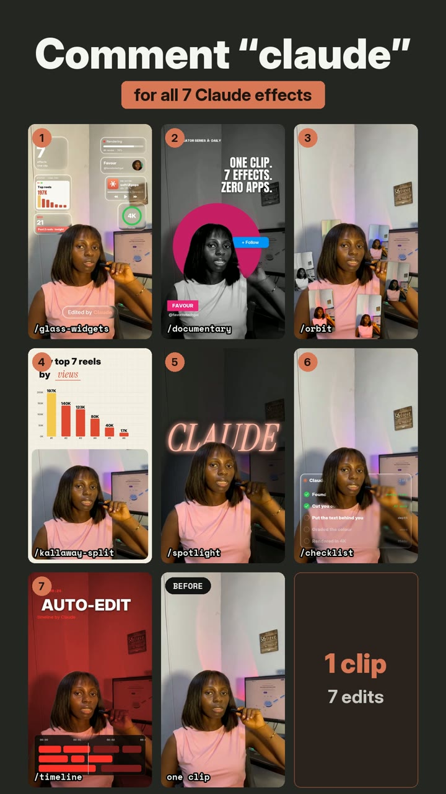

# 20 Free Video Effects for Claude

Drop your video into Claude, type `/effects` and the name of an effect. Claude adds it for you.

By Favour ([@favoritetechgal](https://instagram.com/favoritetechgal)) 💛



**Watch the demo:** [one clip, 7 completely different edits](assets/demo.mp4)

## Install

Open Claude Code and paste:

> **Install the skill from github.com/Favour-Nwachukwu/claude-video-effects into ~/.claude/skills/effects**

Claude does the rest. Restart Claude Code when it's done.

## Use it

1. Open Claude Code.
2. Drag your video into the chat.
3. Type the effect you want:

```
/effects orbit from 3 to 6 seconds
/effects spotlight when I say "kill the lights"
/effects comment-box at the end
```

The first time, Claude sets itself up (a couple of minutes).

## The 20 free effects

| # | Type this | What happens |
|---|---|---|
| 1 | `noise` | Reels pile up behind your head |
| 2 | `lineup` | Numbered tiles fan out above your head |
| 3 | `locked-on` | Brackets lock onto your face and the camera follows you |
| 4 | `orbit` | Your reels circle your head |
| 5 | `lean-in` | A quick punch-in on one word |
| 6 | `backdrop-word` | A giant word drops in behind you |
| 7 | `spotlight` | Kill the lights, keep you lit |
| 8 | `the-bill` | Your instructions print out like a receipt |
| 9 | `moody` | A moody colour grade |
| 10 | `swipe` | A before and after slider |
| 11 | `todo` | A checklist beside your head that ticks off as you talk |
| 12 | `comment-box` | An Instagram comment types itself and posts |
| 13 | `tap` | A Follow button flips to Following |
| 14 | `pause-point` | Freeze frame with a hand-drawn arrow |
| 15 | `reject-stamp` | A big red stamp slams down |
| 16 | `countdown-flip` | A 3, 2, 1 flip clock above your head |
| 17 | `scribble` | Marker doodles draw themselves around you |
| 18 | `headline-box` | A punch-in with a clean two-line headline |
| 19 | `split-headline` | A headline card slides down and pushes you to the bottom half |
| 20 | `messages` | iMessage notifications pop in one after another |

Bonus look: `/effects glitter-spotlight`.

## Good to know
- These are **starter versions**. A finished reel also has sound design, captions and hand-tuned timing.
- Vertical phone videos with you in frame work best.
- It drafts, you approve. Watch the result before you post.

## Want the full pack, or help getting it right?
The demo above uses effects from my **full pack**: glass widgets, liquid glass graphs, 3D carousel, place-in-grid, documentary, chart splits and more.

If you'd like the full pack, or you'd like me to set it up and tune it for your videos so it looks like the demo, send me a DM on Instagram: **[@favoritetechgal](https://instagram.com/favoritetechgal)**

## Credits
Face tracking: [OpenCV YuNet](https://github.com/opencv/opencv_zoo) (MIT). Person cut-out: [MediaPipe Selfie Segmenter](https://ai.google.dev/edge/mediapipe/solutions/vision/image_segmenter) (Apache 2.0). Fonts: Archivo Black, Instrument Serif, Space Mono, Inter, Anton, Montserrat (SIL OFL) and Permanent Marker (Apache 2.0); licences are in `fonts/`. Everything else: MIT, see `LICENSE`. Based on an MIT-licensed effects pack (see `LICENSE`).
